# Open RPA Studio

Open RPA Studio is a local-first, open-source desktop environment for visually authoring and executing automations. It is an independent application: it does not use Flowbench code, services, branding, or runtime components.

This repository contains the editor, the versioned workflow format, a separate Python execution engine, optional automation adapters, and packaging/build scripts. The product is under active development. It is a capable early release, not yet a certified enterprise RPA platform or a complete UiPath replacement.

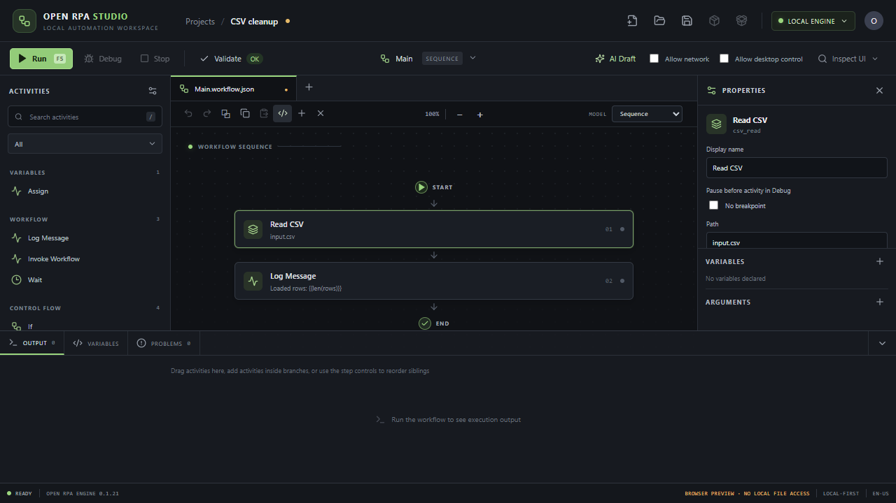

*The screenshot shows the isolated browser preview and the flowchart minimap. Desktop-only capabilities such as filesystem access and Windows UI Automation are available in the installed application, not in this preview.*

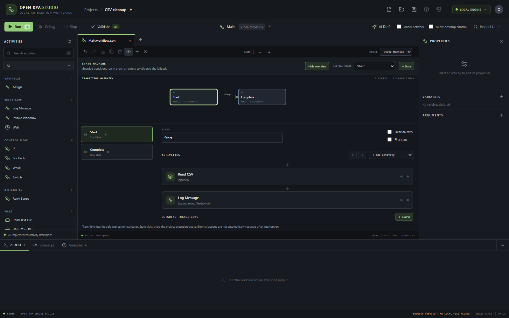

*State-machine overview nodes are generated from the executable state and transition definitions. Select a node to edit that state's activities and guards.*

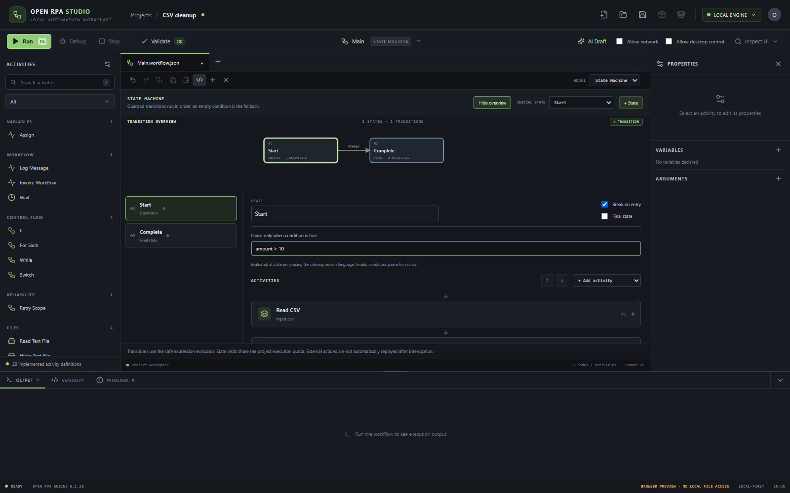

*Conditional breakpoints on flowchart nodes and state-machine entries use the safe expression language; invalid conditions pause for review.*

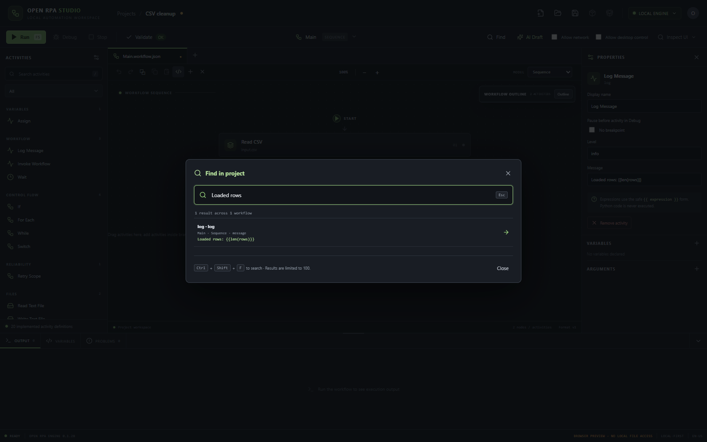

*Find configured content across project workflows, nested branches and graph models with Ctrl+Shift+F, then jump to the matching activity or state.*

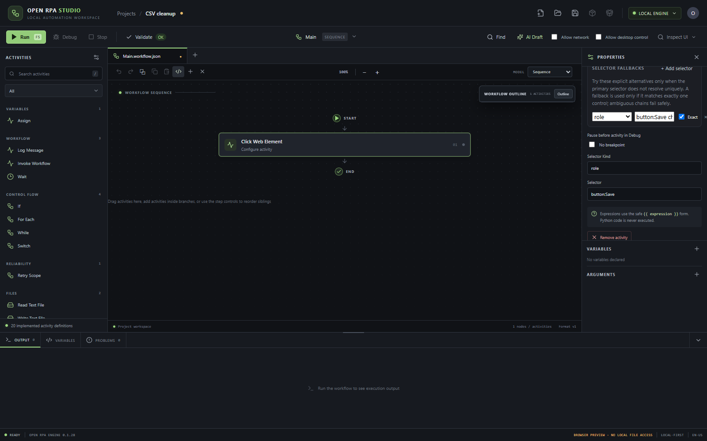

*Browser workflows can use up to ten author-defined alternatives. The engine uses a fallback only when exactly one alternative resolves uniquely and records the choice without logging selector text.*

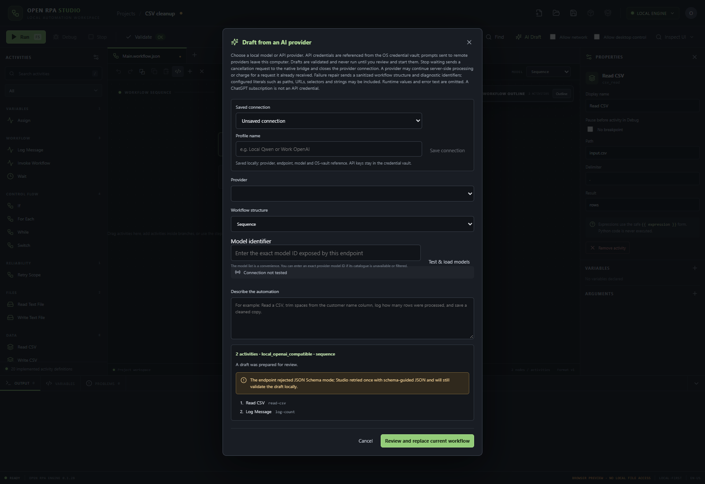

*The draft panel discloses a schema-guided retry when a compatible endpoint rejects JSON Schema mode. The local HTTP acceptance test verifies the adapter exchange; this screenshot illustrates the resulting UI state.*

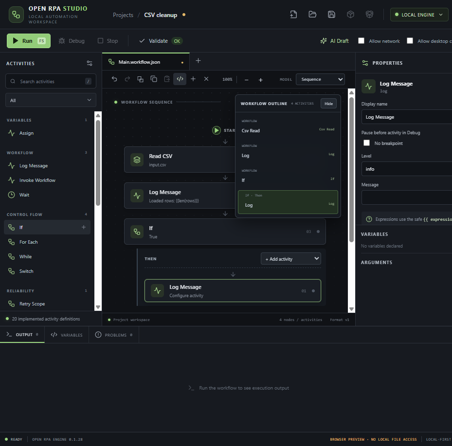

*The workflow outline includes branch context for nested activities and stays pinned while the canvas scrolls. Select an entry to focus that activity and open its properties.*

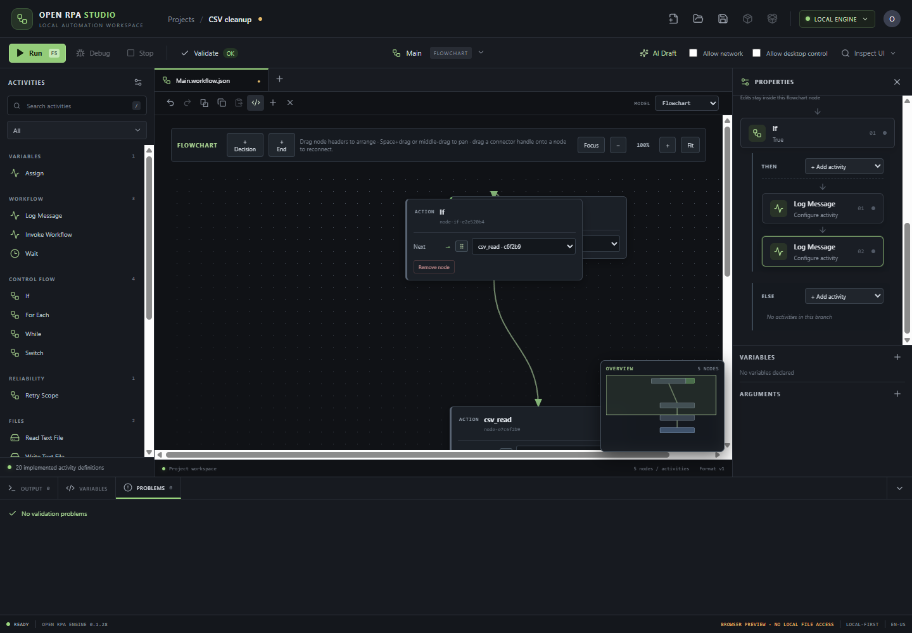

*Flowchart action nodes can contain nested control flow. Add and edit branch activities from the action inspector; these activities remain part of that executable graph node.*

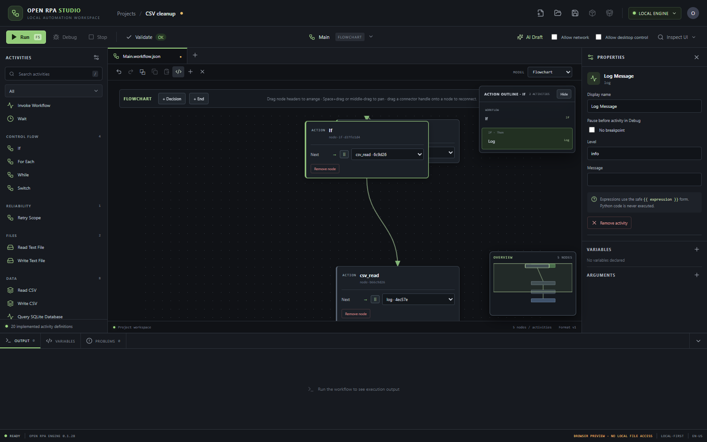

*Select a flowchart action to open its scoped outline. Branch paths remain visible while selecting nested activities, and the corresponding graph action stays highlighted.*

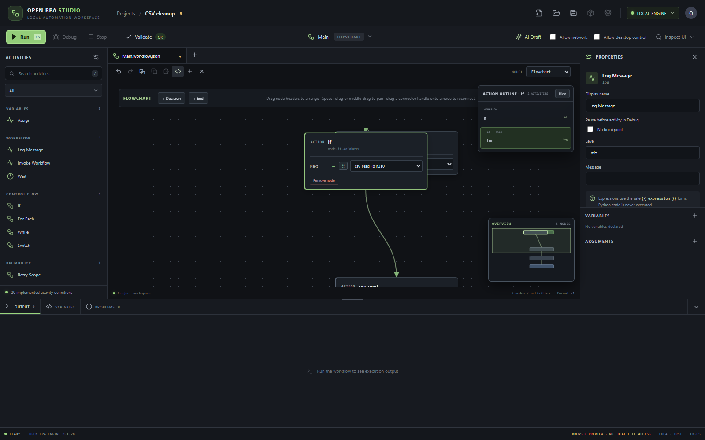

*Drag the divider above Output or focus it and use the arrow keys. Home and End move to the available bounds, and Escape restores the default height.*

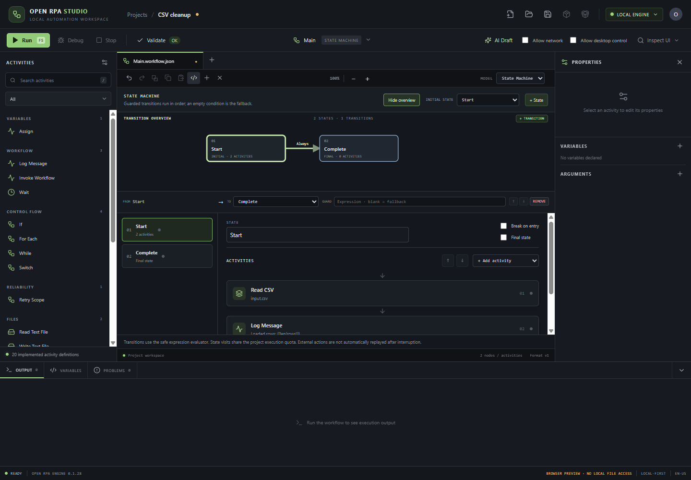

*Select a transition edge to edit its destination or guard, reorder guarded routes, remove it, or add a new safe False-guarded route. Blank guards represent the fallback and remain last.*

Execution history now opens full saved run records with activity durations, event timestamps, workflow digests, errors and clear interruption warnings. Interrupted runs are inspectable and are never silently replayed.

The AI drafting panel can also prepare a workflow repair from the latest failed run. It excludes runtime variable values, argument defaults and raw error text from the repair prompt, then requires validation and review before replacing the current workflow. Remote providers may receive configured literals from the workflow.

Before every run, Studio now shows an impact review that expands saved child workflows, identifies file reads and writes, highlights destructive operations, and requests network or desktop permission for that run only. The review is a static plan: expressions and runtime data can still change actual targets. See [Run impact review](docs/RUN-IMPACT-REVIEW.md) for coverage and limits.

## Download and install

The unsigned Windows development installer is available from the [Open RPA Studio v0.1.28 release](https://github.com/stevenmcsorley/open-rpa-studio/releases/tag/v0.1.28). The package is for evaluation and is not code-signed.

The NSIS installer supports a per-user installation and uninstall. The app bundle includes a frozen Python bridge, so Python does not need to be installed on the target computer. Windows WebView2 is required; current Windows 10/11 installations normally provide the Evergreen runtime. The packaged Playwright adapter also needs a browser binary. Browser binaries are not included in this installer, so browser automation will report unavailable until Chromium is installed in a compatible Playwright environment. Runtime capability status is displayed by the app rather than inferred from package presence.

The v0.1.28 installer is unsigned. Windows SmartScreen may show an unknown-publisher prompt. Verify the downloaded file against the SHA-256 in the release before running it:

```powershell
Get-FileHash .\release\Open-RPA-Studio-Setup-0.1.28-x64.exe -Algorithm SHA256
```

## Build the Windows installer

### Prerequisites

- Windows 10/11 x64 and the Microsoft C++ Build Tools (MSVC linker).
- Rust stable with `x86_64-pc-windows-msvc` installed.
- Node.js 20 or newer and npm.
- Python 3.11 or newer plus `uv`.
- WebView2 runtime for launching the packaged desktop app.

From PowerShell:

```powershell
cd open-rpa-studio
npm ci
npm run build:windows-installer
```

The build script locks and syncs the Python dependency graph, freezes the Python bridge with PyInstaller, compiles the Vite and Tauri release builds, and creates an NSIS setup executable. Tauri downloads and hash-checks its pinned NSIS tooling and helper DLL when needed. The resulting setup executable is copied into `release/`; generated engine executables and build outputs are intentionally ignored by Git.

To build the frontend only, run `npm run build`. To build the desktop host without packaging an installer, run `npm run tauri -- build --no-bundle` (or invoke `node_modules/.bin/tauri.cmd` directly if your npm version rewrites option arguments).

## What works today

### Visual authoring

- Project and workflow files use versioned JSON formats (`openrpa.project` and `openrpa.workflow`, format version 1).
- Export and import deterministic `.orpa` project packages from the desktop toolbar. Exports validate workflows and exclude secret files; imports verify the manifest, file hashes and paths before extracting to an empty folder.
- Create and open local projects, add workflows, save, validate, and inspect validation problems.
- Search a categorized activity catalog, configure activity properties, reorder sequence actions, edit nested control-flow branches, and zoom sequence canvases from 50% to 150% with a reset control.
- Search configured text across workflows, nested control-flow branches, flowcharts and state machines with Ctrl+Shift+F. Results show workflow context and navigate to the selected activity or graph element; search excludes credential-like fields and variable or argument defaults.
- Collapse or reopen the Output pane to give the workflow designer more vertical room; the output tabs remain accessible while collapsed.
- Author either a sequence or a flowchart. Flowcharts include Start, action, Decision, and End nodes; transitions, positions, and edits persist in the workflow file. Flowchart action nodes can contain editable nested If/Else, loop, Switch, and Try/Catch/Finally activities in the properties inspector.
- Author a state machine with named states, per-state activity sequences, ordered boolean guards, an explicit initial state, and terminal states. State visits obey the workflow execution quota; interrupted workflows are not automatically replayed.
- See the [workflow format and state-machine example](docs/WORKFLOW-FORMAT.md) and the [architecture notes](docs/ARCHITECTURE.md).
- Convert a linear flowchart to a sequence when it contains no branches or loops.
- Use Excel workbook activities to read .xlsx sheets into records and write records to new workbooks. See [Excel workbook activities](docs/EXCEL-ACTIVITIES.md) for limits, formula handling, archive protections and unsupported features.
- Query approved local SQLite files using parameter-bound read-only SQL, row/result-size quotas, VM timeouts, cancellation and audit events. Writes, `PRAGMA`, attachment, and multi-statement SQL are denied. See [SQLite Query activity](docs/SQLITE-ACTIVITY.md).
- Extract selectable text from local PDFs with page separators, configurable page limits, page-count output and run cancellation checks. Scanned/image-only PDFs need an external OCR process; encrypted files are rejected. See [PDF activity limits](docs/PDF-ACTIVITIES.md).
- Query approved local SQLite files with parameter-bound, read-only SQL, result/time limits, cancellation and durable audit events. See [SQLite Query activity](docs/SQLITE-ACTIVITY.md).
- Insert ordinary activities in the selected flowchart path while preserving downstream transitions.
- Pan a large flowchart with Space+drag or middle-drag, center the selected node, and reconnect a transition by dragging its connector handle onto a destination node. The minimap shows the whole graph, selected node and visible viewport; click it to navigate. The accessible destination selector remains available for keyboard editing.
- Undo and redo workflow edits across sequence, flowchart, state-machine, activity properties, variables and arguments using the toolbar or Ctrl+Z/Ctrl+Y (Cmd+Z/Cmd+Y on macOS). Each workflow keeps a bounded 100-step edit history; loading another project clears the prior project's history.
- Duplicate a selected activity beside its source with Ctrl/Cmd+D or the canvas toolbar. Control-flow descendants and switch cases receive fresh activity IDs, so duplicated breakpoints and execution results remain independent. Works in sequences, state-machine states and flowchart action paths.
- Copy and paste activity subtrees within the Studio clipboard using Ctrl/Cmd+C and Ctrl/Cmd+V or the canvas controls. Paste inserts after the current selection, remaps IDs on every paste, works across workflows and does not access the system clipboard.
- Use the visible, permission-gated Playwright inspector to discover named page controls and add editable click, fill, select, check, uncheck, and read-text actions.
- On Windows, inspect visible application windows and accessible controls with UI Automation; on Linux, inspect controls through the AT-SPI accessibility bus. Both adapters add editable click, set-text, read-text, and wait activities using exact window titles and accessible names/IDs. Ambiguous selectors fail closed, and password controls are omitted.
- Generate a candidate workflow from an optional AI provider, review the validation output, then explicitly insert the draft. Generated workflows are not run automatically.
- Invoke reusable project workflows through a dedicated argument-mapping editor. Map typed inputs and per-call output variables; project validation catches missing required arguments, unknown names and incompatible directions before execution.
- Choose whether AI drafts an activity sequence, connected flowchart, or state machine. Model-specific schemas and the same local workflow validator are applied before a draft can replace the current workflow.
- Stop an in-flight AI draft from the native Studio panel; cancellation travels through the bridge to the provider socket, while warning that a provider may continue processing after it receives a request.
- Test configured AI endpoints from the model picker. Studio reports reachability, model count and request time, and distinguishes an empty model catalogue from a connection failure without sending a prompt.
- Connect a compatible AI agent to one project over the local stdio Model Context Protocol server. It supports project/workflow discovery, the canonical native activity catalog, workflow reading, validation, opt-in creation and updates with optimistic concurrency, permission planning and opt-in execution. Permission planning flags browser navigation as network access. The Windows installer bundles this command in `engine/openrpa-bridge.exe`; see [MCP client integration](docs/MCP-INTEGRATION.md).

### Workflow execution

The Python engine is separate from the UI process and can also run from the command line. Supported control flow includes If/Else, For Each, While, Switch, Retry Scope with explicit repeat-safety acknowledgement, Try/Catch/Finally, flowcharts, and reusable workflow invocation with typed arguments. The expression evaluator accepts a bounded expression grammar and never calls `eval()` on workflow text.

Core activities include variable assignment and logging; credential lookup by vault reference; file read/write/copy/move/delete/list operations; text/regex processing; JSON, CSV and XLSX data operations; wait; HTTP requests; browser actions; Windows UI Automation; Linux AT-SPI desktop accessibility; screenshots; and optional desktop coordinates. Activity permissions, quotas, validation, structured logs, and execution status are handled by the engine, not simulated by the editor.

### Debugging and run history

- Boundary-based breakpoints and debugger start-paused mode.
- Conditional breakpoints on activities, flowchart nodes and state-machine entries use the safe expression language. False conditions continue; true conditions pause, and invalid conditions pause for review rather than being silently ignored.
- Pause, continue, step-over, step-into, step-out, and cancellation at activity boundaries.
- Inspect variables and edit supported JSON-compatible values while paused, subject to type and credential protections.
- Add watch expressions using the safe workflow expression language. Watches evaluate against the live engine scope only while paused, with registered secrets redacted and large results truncated.
- Durable SQLite run history records workflow digests, times, statuses, activity events, errors, and security audit events.
- Interrupted runs are marked for inspection; they are never resumed or repeated automatically because prior activities may have changed external systems.

### Optional AI providers

The core editor and execution engine work without an AI model or network access. Workflow drafting has adapters for:

- Ollama.
- LM Studio.
- OpenAI-compatible local servers on loopback.
- OpenAI API (including API access to OpenAI models; a ChatGPT subscription is not an API credential).
- OpenAI API through either Chat Completions or the Responses API, selectable as separate profiles.
- Anthropic Claude API.
- OpenRouter.
- Compatible remote HTTPS endpoints configured by the user.

The model picker accepts typed model IDs as well as discovered IDs. This lets compatible endpoints work when their model catalogue is disabled or filtered; the chosen ID is still sent to the selected provider and provider errors remain visible.

Provider credentials are references into the operating-system credential vault (Windows Credential Manager, macOS Keychain, or Linux Secret Service). In the desktop AI panel, enter a key into the password field and choose **Store API key securely**; the key is sent to the local bridge, stored in the OS vault, then cleared from the form. Save named connection profiles to remember provider, endpoint, model and vault references across launches. Profiles contain no credentials. Alternatively, use `openrpa credential SERVICE USERNAME`. Secrets are never placed in workflow files or audit records. Remote prompts disclose the provider route before a request. Task descriptions are JSON-encoded user content, separate from system instructions; this does not eliminate prompt injection. AI output is treated as untrusted, parsed as a bounded schema, validated by the workflow validator, and requires user review before insertion. Local models are optional; unavailable providers do not disable non-AI features.

This is a set of provider-protocol adapters, not a promise that every model endpoint implements tool calling or structured output identically. Some compatible servers may reject schema-constrained requests.

### Browser and desktop adapters

Browser activities use Playwright with role, label, text, placeholder, test-id, or CSS selectors. The library includes explicit element waits and visible/hidden/enabled/disabled/checked/text assertions with activity-scoped timeouts. The Browser Inspector uses a visible browser, permission-gated navigation, request destination checks, and editable selector-based actions. Its interaction recorder captures bounded click, fill, selection, and checkbox actions for uniquely identified named controls, including across page navigation in one browser tab. It records selector metadata only: it does not read typed values, and it excludes password, email, payment, file, and hidden fields. Generated fill/select activities have blank values and must be reviewed before use. The bridge checks Playwright and Chromium availability at runtime. Install Chromium for development with:

```powershell
uv sync --locked --extra dev --extra browser
uv run playwright install chromium
```

Windows UI Automation is available through the optional `desktop` extra and the Studio's **Inspect UI → Inspect Desktop UIA** picker. It reads visible control metadata only, excludes password controls, rejects ambiguous selectors, and creates ordinary editable workflow activities. Every desktop inspection and interaction requires explicit desktop permission. Linux semantic inspection and interaction are implemented through AT-SPI/AT-SPI2; their availability depends on the distribution bindings and an active accessibility bus. Linux coordinate-based fallback uses optional PyAutoGUI and is less resilient than semantic selectors.

## Safety and security model

Workflows can act on files, networks, browsers, or desktop sessions. Only run workflows and packages you trust.

- File paths are confined to the project root plus explicitly configured extra roots. Path traversal, unsafe project paths, and unapproved writes are rejected.
- Network activities are disabled until a run is explicitly granted network permission. HTTP requests validate DNS/IP destinations, block private/special-use networks, pin the checked address, cap ports/timeouts/response sizes, and disable redirects. Browser navigation also checks destinations and blocks WebSockets/service workers/downloads in inspection mode; Chromium resolves hostnames itself, so browser DNS-rebinding protections are not equivalent to a pinned HTTP connection.
- Desktop automation is permission-gated each run.
- Credential values come from supported OS vaults. Unsupported plaintext/fallback keyrings are refused. Secret-bearing values are redacted in returned state and logs.
- Workflow expressions are parsed by a constrained evaluator. There is no general-purpose Python or JavaScript activity in the default catalog.
- Imported project files and `.orpa` packages are validated. Package extraction rejects unsafe/duplicate paths, symlinks, excessive sizes, and suspicious compression ratios. `.orpa` hashes provide integrity checks, not publisher identity; packages are not digitally signed.
- AI-generated workflow data is not trusted code. It is schema-checked and workflow-validated before a person may insert it.
- Security controls are still undergoing adversarial testing; see [SECURITY.md](SECURITY.md) for the current threat model and reporting process.

## Project and workflow format

A project contains a `project.json` manifest and workflow JSON documents, commonly under `workflows/`. The project manifest maps workflow names to project-relative paths and names a main workflow. Each workflow declares format/version, variables, arguments, execution model, and activities (or flowchart graph data).

Use the CLI to validate, execute, package, or unpack a project:

```powershell
uv sync --locked --extra dev
uv run openrpa validate examples/csv-cleanup/project.json
uv run openrpa run examples/csv-cleanup/project.json
uv run openrpa pack examples/csv-cleanup .\csv-cleanup.orpa
uv run openrpa unpack .\csv-cleanup.orpa .\csv-cleanup-copy
```

Package export is deterministic for the same source contents, carries per-file SHA-256 integrity checks, and excludes environment files, key material, and certificates. Workflow and package validation limits are enforced before execution or extraction.

## Development

The codebase has three primary components:

- `src/studio/`: React/TypeScript application, visual authoring components, state helpers, and Tauri RPC client.
- `src-tauri/`: Rust desktop shell, secure local bridge process lifecycle, OS dialogs, and release bundle configuration.
- `openrpa/`: Python workflow format, validator, execution engine, activities, browser inspector, provider adapters, debugger, package manager, and durable run history.

Install and run the editor in development mode:

```powershell
cd open-rpa-studio
uv sync --locked --extra dev
npm ci
npm run tauri dev
```

The desktop host starts the Python module in development when `OPENRPA_PYTHON` is not configured; set it to the desired Python executable to select another interpreter. On Windows, the bridge runs with redirected standard streams and `CREATE_NO_WINDOW`; it must not open a terminal window. Packaged Windows releases instead launch `engine/openrpa-bridge.exe` from the installer resources and do not look for Python on `PATH`.

For browser automation and local browser inspection in development, install the browser extra and Chromium as shown above. For OS keyring and desktop extras, use:

```powershell
uv sync --locked --extra dev --extra browser --extra desktop --extra credentials
```

## Tests and verification

Run focused checks:

```powershell
uv run --locked --extra dev pytest -q
npm test
npm run build
```

Build and smoke-install the Windows release using `npm run build:windows-installer`. The changelog records release smoke evidence and artifact hashes. The Tauri host uses Windows `CREATE_NO_WINDOW` for the bridge subprocess to prevent a console window from appearing.

## Known gaps

This project has not yet reached the stated beyond-UiPath parity goal. The editor supports sequences, flowcharts, and state machines, but major unfinished areas include automatic fuzzy selector healing (explicit fallback chains are supported), broader cross-toolkit accessibility acceptance, production-grade plug-in/package signing, upgrade/uninstall and clean-machine installer testing, workflow collaboration, unattended scheduling/orchestration, and adversarial security review. The included installer is a development artifact, unsigned, and not production-certified. The `examples/` workflows are fixtures and should be reviewed before execution.

The current Windows installer bundles the engine bridge and its Python dependencies, but not a Playwright browser binary. Browser adapter readiness is detected at runtime; install a matching browser binary separately if browser automation is required. Windows Desktop automation via PyAutoGUI may require interactive session access and explicit user permissions.

## Documentation

- [Architecture](docs/ARCHITECTURE.md)
- [SQLite Query activity](docs/SQLITE-ACTIVITY.md)
- [Security model and reporting](SECURITY.md)
- [Adapter details and limitations](docs/AUTOMATION_ADAPTERS.md)
- [AI workflow drafting: supported structures and live verification](docs/AI-DRAFTING.md)
- [Workflow format and execution models](docs/WORKFLOW-FORMAT.md)
- [Product roadmap](docs/ROADMAP.md)
- [Reverse-engineering evidence and behavior notes](docs/REVERSE_ENGINEERING_EVIDENCE.md)
- [CycloneDX SBOM](sbom.cdx.json)

## License

See [LICENSE](LICENSE).
